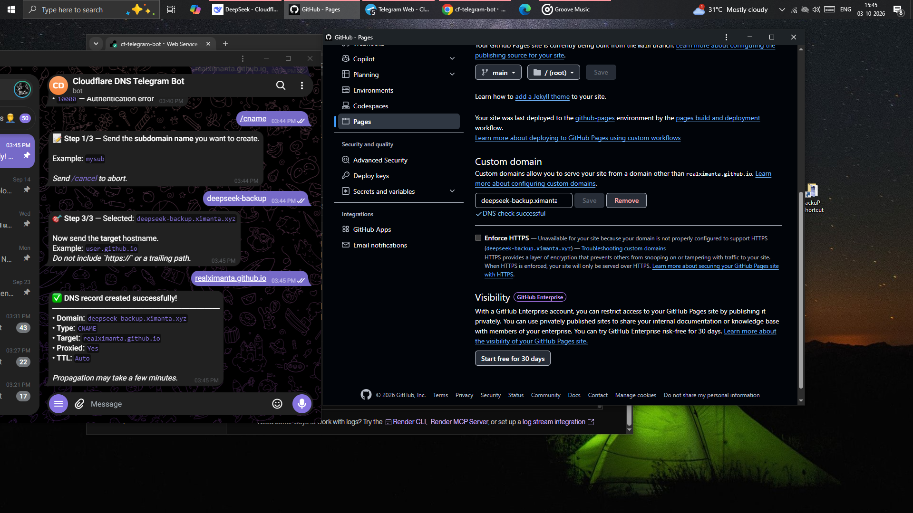

<div align="center">

<!-- Animated capsule banner -->


<!-- Animated typing banner -->
<a href="https://github.com/realximanta/cf-telegram-bot">
  
</a>

<!-- Badges (some are dynamic/animated) -->
<p>
  <a href="https://github.com/realximanta/cf-telegram-bot/stargazers">
    
  </a>
  <a href="https://github.com/realximanta/cf-telegram-bot/network/members">
    
  </a>
  <a href="https://github.com/realximanta/cf-telegram-bot/blob/main/LICENSE">
    
  </a>
</p>

<p>
  
  
  
  
</p>

<!-- Animated divider -->


</div>

---

## ✨ What is this?

A **long-polling Telegram bot** that lets you create, inspect, and delete Cloudflare DNS records from Telegram — no more opening the heavy Cloudflare dashboard on prepaid mobile data.

- 🎯 **Interactive flow** — inline buttons list every domain in your Cloudflare account
- 📋 **Browse records** — paginated record list with per-record detail view
- 🟠 **Proxy toggle** — flip the orange cloud on or off for any proxiable record
- 🗑 **Safe deletes** — every deletion requires an explicit confirmation tap
- 🔒 **Locked to you** — only whitelisted Telegram chat IDs can use it
- 💸 **Data-cheap** — a full DNS change uses **< 1 KB** vs **2–5 MB** on the web UI
- 🩺 **Self keep-alive** — ships a `/health` endpoint for Render + UptimeRobot
- 🧩 **Zero cost** — Render free tier + UptimeRobot free tier

---

## 🎬 Live Flow Preview

<div align="center">
  
</div>

<div align="center">

```text
You:  /cname
Bot:  📝 Step 1/4 — Send the subdomain you want to create. Example: ximanta

You:  ximanta
Bot:  🌐 Step 2/4 — Pick the domain for ximanta:
      [ ximanta.ximanta.xyz ]
      [ ximanta.ximanta.space ]
      [ ximanta.dev-ximanta.site ]
      [ ximanta.kaziranga.site ]
      [ ❌ Cancel ]

You:  (taps ximanta.ximanta.xyz)
Bot:  🎯 Step 3/4 — Selected: ximanta.ximanta.xyz
      Now send the target hostname. Example: realximanta.github.io

You:  realximanta.github.io
Bot:  🟠 Step 4/4 — Proxy this record through Cloudflare?
      [ 🟠 Proxied — orange cloud ]
      [ ⚪ DNS only — grey cloud ]
      [ ❌ Cancel ]

You:  (taps ⚪ DNS only)
Bot:  ✅ DNS record created successfully!
      • Domain: ximanta.ximanta.xyz
      • Type:   CNAME
      • Target: realximanta.github.io
      • Proxied: No
      • TTL:     Auto
```

</div>

---

## 🚀 Quick Start

### Option A — Fork the repo (recommended)

1. Click the **Fork** button at the top-right of
   [github.com/realximanta/cf-telegram-bot](https://github.com/realximanta/cf-telegram-bot).
2. On your fork, click **Code → HTTPS** and copy the URL.
3. Continue to [Clone & run](#option-b--clone-the-repo).

### Option B — Clone the repo

```bash
# HTTPS
git clone https://github.com/realximanta/cf-telegram-bot.git

# SSH (if you have SSH keys configured)
git clone git@github.com:realximanta/cf-telegram-bot.git

# GitHub CLI
gh repo clone realximanta/cf-telegram-bot

# Clone into a specific folder
git clone https://github.com/realximanta/cf-telegram-bot.git my-dns-bot
cd my-dns-bot
```

Then:

```bash
python -m venv .venv
source .venv/bin/activate         # Windows: .venv\Scripts\activate
pip install -r requirements.txt
cp .env.example .env              # fill in your secrets
python bot.py
```

---

## 🛠️ Setup Guide

### 1. Create a Telegram bot

1. Message [@BotFather](https://t.me/BotFather) → `/newbot` → copy the token.
2. Message [@userinfobot](https://t.me/userinfobot) → copy your numeric ID.

### 2. Create a Cloudflare API token

1. Go to [Cloudflare API Tokens](https://dash.cloudflare.com/profile/api-tokens).
2. Click **Create Token → Edit zone DNS** template.
3. Permissions: `Zone → DNS → Edit` and `Zone → Zone → Read`.
4. Zone Resources: restrict to the specific zones you want the bot to touch.
5. Copy the token.

> **Why both permissions?** `Zone:Zone:Read` lets the bot list your domains; `Zone:DNS:Edit` lets it create, update, and delete records. The bot never needs account-level permissions.

### 3. Deploy to Render (free)

1. Push the repo to your GitHub (fork already does this).
2. Go to [Render Dashboard](https://dashboard.render.com/) → **New → Blueprint**.
3. Select your repo — Render reads `render.yaml` automatically.
4. Fill the three secret env vars:
   - `TELEGRAM_TOKEN`
   - `CF_API_TOKEN`
   - `ALLOWED_CHAT_IDS` (your numeric Telegram ID)
5. Deploy. You'll get a URL like
   `https://cf-dns-telegram-bot.onrender.com`.

### 4. Keep it alive with UptimeRobot

Render's free tier sleeps after ~15 minutes of inactivity.

1. Sign up at [UptimeRobot](https://uptimerobot.com/).
2. **Add Monitor → HTTP(s)**.
3. URL: `https://<your-render-service>.onrender.com/health`
4. Interval: **5 minutes**.
5. Save. Your bot now stays awake 24/7.

---

## 📖 Commands

| Command   | Description                                      |
| --------- | ------------------------------------------------ |
| `/start`  | Show the help message                            |
| `/help`   | Same as `/start`                                 |
| `/cname`  | Create a CNAME record (4-step flow)              |
| `/list`   | Browse a zone, inspect records, toggle proxy     |
| `/delete` | Pick a zone and delete a record with confirmation |
| `/cancel` | Abort the current `/cname` flow                  |

---

## 🗂 Managing existing records

### Browse with `/list`

1. Pick a domain from the inline keyboard.
2. Records are shown **8 per page**, with `‹ Prev` / `Next ›` navigation.
3. Tap any record to open its detail view:
   - **Name, type, content, TTL, record ID**
   - **🟠 Enable / Disable proxy** — only shown when the record is proxiable
     (A, AAAA, and CNAME records; not TXT, MX, or NS)
   - **🗑 Delete record**
   - **‹ Back to list**

### Delete with `/delete` or from `/list`

Both paths reach the same confirmation screen:

```text
🗑 Delete this record?
━━━━━━━━━━━━━━━━━━━━━━
• Name:    old.example.com
• Type:    CNAME
• Content: old-target.example.net

This cannot be undone.

[ ✅ Yes, delete ]  [ ↩️ No, go back ]
```

Nothing is deleted until you tap **Yes, delete**. After deletion the list refreshes automatically.

### Proxy toggle

The orange cloud can be flipped in two places:

- **During `/cname`** — Step 4/4 asks whether the new record should be proxied.
- **After creation** — open any proxiable record from `/list` and tap the toggle.

Cloudflare's `PATCH /zones/{zone_id}/dns_records/{record_id}` updates only the `proxied` field, so the rest of the record is untouched.

---

## 🧱 Project Structure

```text
cf-telegram-bot/
├── bot.py                 # Main bot: handlers, Cloudflare client, health server
├── requirements.txt       # Python dependencies
├── render.yaml            # Render Blueprint
├── .env.example           # Env template
├── .gitignore
├── README.md
├── index.html             # GitHub Pages landing page
├── 404.html
├── manifest.webmanifest
├── robots.txt
├── sitemap.xml
├── CNAME
└── assets/                # Landing page images and icons
```

`bot.py` is intentionally a single module. It is organised into clear sections:
config → errors → Cloudflare API → validation/formatting → UI builders → command handlers → `/cname` conversation → `/list` and `/delete` callbacks → health server → bootstrap.

---

## 🔐 Security

- The bot **only responds** to chat IDs listed in `ALLOWED_CHAT_IDS`.
- Scope your Cloudflare token to specific zones — never use a Global API Key.
- `.env` is ignored by git; secrets live only in Render's environment.
- **Destructive actions are confirmed.** Deletion requires a second explicit tap.
- **Stale buttons cannot mutate state.** Every inline keyboard carries a short per-session token; a button from an old `/list` session is rejected with “This menu expired.”
- **All user-supplied values are HTML-escaped** before being sent back to Telegram, so a record named `foo_bar` or a target containing `*` cannot break message formatting.

---

## 🧪 Local Development

```bash
git clone https://github.com/realximanta/cf-telegram-bot.git
cd cf-telegram-bot
python -m venv .venv && source .venv/bin/activate
pip install -r requirements.txt
cp .env.example .env
# edit .env with your TELEGRAM_TOKEN, CF_API_TOKEN, ALLOWED_CHAT_IDS
python bot.py
```

The health endpoint is available at `http://localhost:8080/health` while the bot is running.

---

## ⚙️ How it works

- **Long polling**, no webhook. The bot calls `getUpdates` and processes updates in-process. No public URL is required for Telegram itself.
- **One shared `aiohttp.ClientSession`** for all Cloudflare calls, created in `post_init` and closed in `post_shutdown`. This reuses TLS connections and avoids a handshake per DNS operation.
- **15-second timeout** on every Cloudflare request (`connect=5s`), instead of aiohttp's 5-minute default.
- **Pagination is followed**, not truncated. Zones and DNS records are read page by page using `result_info.total_pages`. Record lists are capped at 1,000 entries with a visible warning.
- **Errors are classified.** Cloudflare API errors (`success: false`) produce a readable bullet list; network timeouts produce “Could not reach Cloudflare.” A non-JSON 429/502/503 body produces an HTTP status message instead of a JSON decoder traceback.
- **HTML parse mode** with explicit escaping, rather than legacy Markdown or MarkdownV2's long escape list.

---

## 🗺️ Roadmap

- [x] `/cname` creation
- [ ] `/a`, `/aaaa`, `/txt`, `/mx` records
- [x] `/list` records per zone
- [x] `/delete` with confirmation
- [x] Proxy toggle (orange cloud on/off)

The remaining item — multi-type record creation — is the next milestone. The Cloudflare helpers and validation layer are already generic enough to support it; only the conversation states and per-type validation need to be added.

PRs welcome — see [Contributing](#-contributing).

---

## 🤝 Contributing

1. Fork the repo.
2. Create a feature branch: `git checkout -b feat/awesome-thing`.
3. Commit: `git commit -m "feat: add awesome thing"`.
4. Push: `git push origin feat/awesome-thing`.
5. Open a Pull Request.

Please keep changes surgical: one feature per PR, no unrelated refactors, and update this README when behaviour changes.

---

## 📬 Contact

<div align="center">

**Author:** [@realximanta](https://github.com/realximanta) · **Email:** [realximanta@gmail.com](mailto:realximanta@gmail.com)

<a href="https://github.com/realximanta">
  
</a>
<a href="mailto:realximanta@gmail.com">
  
</a>

</div>

---

## 📄 License

Released under the **MIT License** — see [LICENSE](LICENSE) for details.

<div align="center">


</div>
